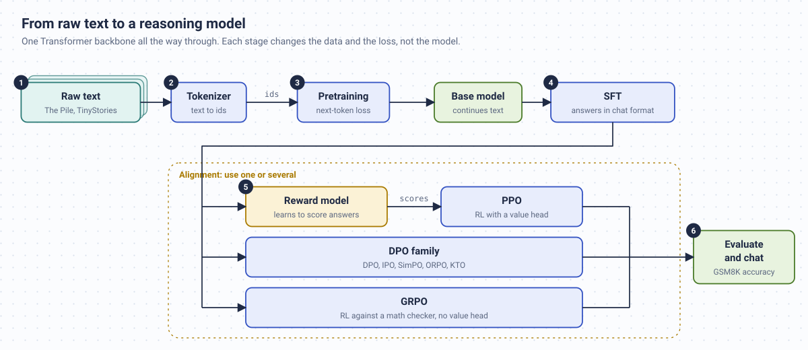
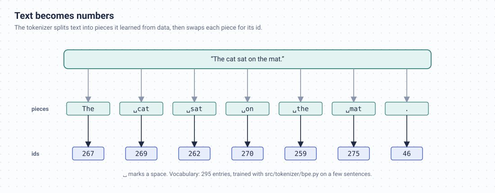
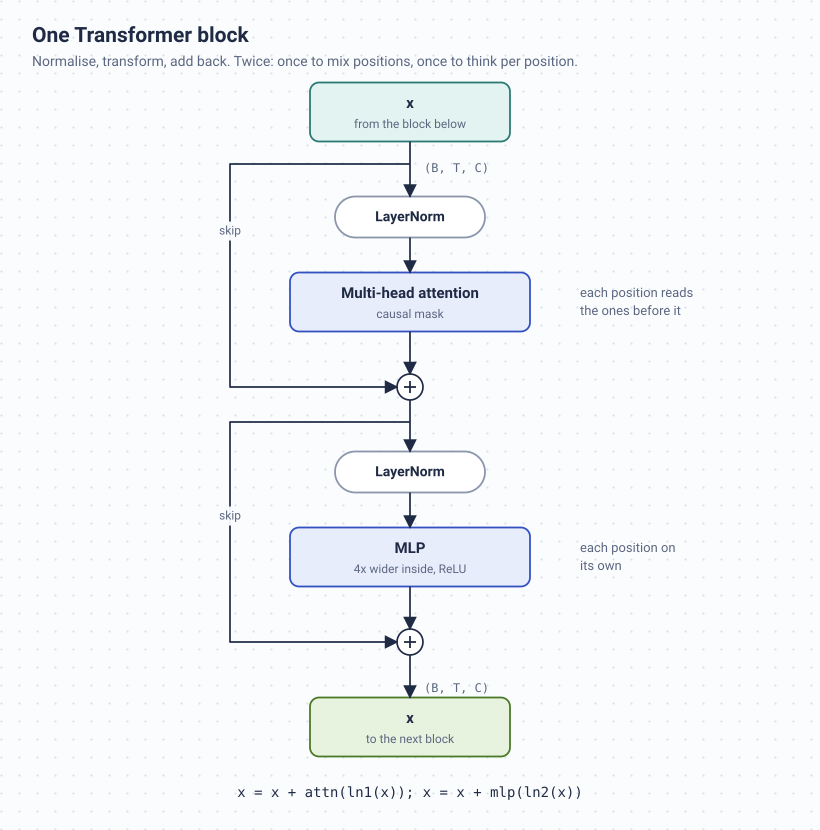
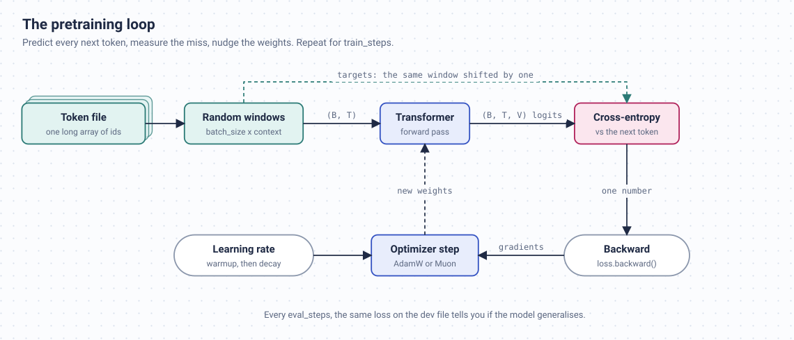
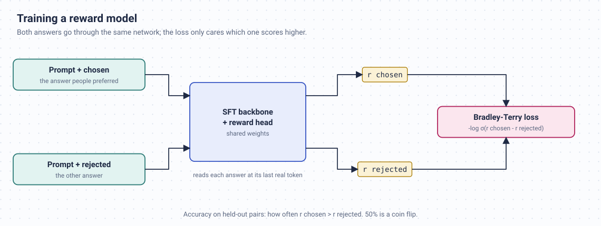
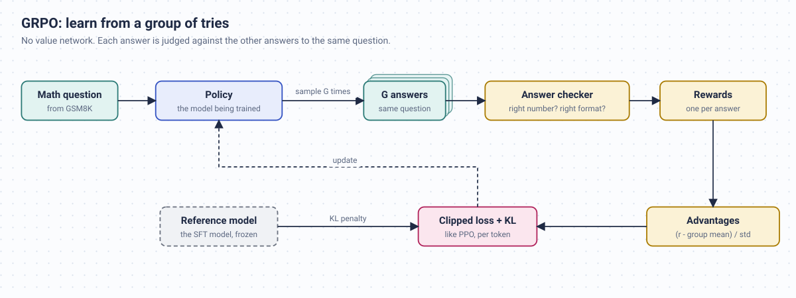

<div align="center">

<!-- omit in toc -->
# Building LLMs From Scratch

**Write every piece of a language model yourself, train it, then teach it to follow instructions.**

[](https://github.com/ghimiresunil/building-llms-from-scratch/actions/workflows/ci.yml)

[](https://docs.astral.sh/uv/)
[](https://www.dynaconf.com/)

[](https://ghimiresunil.github.io/building-llms-from-scratch/)

</div>

Most of us meet language models through an API. You send text, text comes back, and everything in between is somebody else's problem. This repository is the opposite. It's a place to open the box and build the whole machine with your own hands, in plain PyTorch, small enough that you can read all of it.

You'll start with raw text and end with a model that answers questions in a chat format and has been pushed, with reinforcement learning, to get math problems right. Along the way you write the tokenizer, the attention layer, the training loop, and every alignment algorithm people talk about: SFT, reward models, PPO, DPO and GRPO. No `transformers`, no `trl`, no `peft`. When you want to know how something works, the answer is a file in this repo, not a library call.

You don't need a big GPU to get going. The smallest model trains on an ordinary laptop CPU in a few minutes.



<!-- omit in toc -->
## Contents

- [Pick your starting point](#pick-your-starting-point)
- [Install](#install)
- [Settings, and how to change them](#settings-and-how-to-change-them)
- [Logging](#logging)
- [What's in the box](#whats-in-the-box)
- [The learning path](#the-learning-path)
  - [1. Text becomes numbers](#1-text-becomes-numbers)
  - [2. Building the Transformer](#2-building-the-transformer)
  - [3. Pretraining](#3-pretraining)
  - [4. Sampling text](#4-sampling-text)
  - [5. Making it an assistant: SFT](#5-making-it-an-assistant-sft)
  - [6. Learning from preferences: reward model and DPO](#6-learning-from-preferences-reward-model-and-dpo)
  - [7. Reinforcement learning: PPO and GRPO](#7-reinforcement-learning-ppo-and-grpo)
  - [8. Measuring progress and chatting](#8-measuring-progress-and-chatting)
- [Classic vs. modern architecture](#classic-vs-modern-architecture)
- [How big a model can I train?](#how-big-a-model-can-i-train)
- [Tests and checks](#tests-and-checks)
- [Troubleshooting](#troubleshooting)
- [Contributing](#contributing)
- [License](#license)

## Pick your starting point

There are three sensible ways in, depending on what hardware you have and how much time you want to spend.

**"I just have a laptop."** Start here even if you do have a GPU. It's the fastest way to see the whole loop work:

```bash
python scripts/prepare_tiny_data.py                   # download TinyStories, train a small BPE tokenizer
python scripts/train_transformer.py --preset tiny     # a few minutes on a CPU
python scripts/generate_text.py --model_path models/tiny.pt
```

The data is [TinyStories](https://arxiv.org/abs/2305.07759), a set of very simple children's stories built for exactly this purpose. A model with a few hundred thousand parameters can learn to write passable sentences from it, which is a genuinely strange thing to watch happen. The [laptop guide](docs/student/README.md) goes deeper.

**"I have one GPU."** Prepare a slice of The Pile and train one of the GPU presets (`13m` or `77m`) with the classic script. That's [section 3](#3-pretraining).

**"I want the whole pipeline."** Pretrain a base model with `scripts/pretrain_base.py`, then run SFT, the reward model, DPO, PPO and GRPO on top of it. Sections 3 to 8 walk through it, and `scripts/run_posttraining.sh` runs the post-training part in one go.

## Install

The project uses [uv](https://docs.astral.sh/uv/) to manage Python and dependencies. If you haven't tried it, it's worth it: one command builds the environment, and `uv.lock` pins every package so your setup matches the one the tests run on.

```bash
git clone https://github.com/ghimiresunil/building-llms-from-scratch.git
cd building-llms-from-scratch
uv sync
```

That creates `.venv/` with the project installed in editable mode, plus the test and lint tools. Then either activate it:

```bash
source .venv/bin/activate        # Windows: .venv\Scripts\activate
```

or leave it inactive and prefix commands with `uv run`, as in `uv run python scripts/train_transformer.py --preset tiny`. The examples in this README assume the environment is active.

Some parts of the project are optional, so they're installed only when you ask for them:

| You want to... | Run |
|---|---|
| download the post-training datasets, log to W&B | `uv sync --extra train` |
| build the documentation site | `uv sync --extra docs` |
| have all of it | `uv sync --all-extras` |

**About PyTorch on Linux.** PyTorch is installed from PyPI. On Linux, that package includes CUDA and is a couple of gigabytes. It works fine on machines without a GPU, it's just a large download. If that bothers you, [the hardware guide](docs/howto/hardware.md) shows how to install the CPU-only build instead. On macOS and Windows you get the small build automatically.

If you'd rather not use uv, `pip install -e ".[train]"` inside any virtual environment also works.

## Settings, and how to change them

Settings live in TOML files in `configs/`. They're loaded with [Dynaconf](https://www.dynaconf.com/), which lets several sources stack on top of each other, so you rarely need to edit the shipped files.

| File | What it controls |
|---|---|
| `configs/presets.toml` | Model sizes for the classic script, chosen with `--preset` |
| `configs/logging.toml` | Log level and format for every script |
| `configs/base.toml` | The model shape and runtime options shared by every post-training stage |
| `configs/pretrain.toml`, `sft.toml`, `reward.toml`, `dpo.toml`, `ppo.toml`, `grpo.toml` | One stage each, holding only that stage's options |

Every file has a `[default]` table that lists every setting with its normal value. Variations are sub-tables of it that only list what they change. The most useful one is `[default.smoke]`, which swaps in a tiny model that runs on the CPU for a handful of steps. Adding `--env smoke` to any post-training command is the quickest way to check that a stage works before you spend real compute on it.

When a value comes from more than one place, the later source in this list wins:

1. `configs/base.toml`
2. the stage's own file, then a file you pass with `--config`, if any
3. a matching `*.local.toml` file, if you create one (git ignores these)
4. the `[default.NAME]` sub-tables, when you pass `--env NAME`
5. environment variables starting with `BLFS_`, or a `.env` file in the project root
6. flags on the command line

There are no defaults hidden in Python. The TOML files are the full list of settings, which is also how typos get caught: a key that isn't in a shipped `[default]` table is rejected.

In practice that looks like this:

```bash
# keep a personal override around, without touching the shipped file
cat > configs/sft.local.toml <<'EOF'
[default]
lr = 2e-5

[default.smoke]
batch_size = 2
EOF

# change something for one shell session
export BLFS_DEVICE=cuda

# change something for a single run
python scripts/train_sft.py --batch_size 8

# check what the run will actually use, then exit
python scripts/train_sft.py --print-config
```

Two details that save confusion. TOML has no `null`, so to unset an optional value write `"none"`, for example `amp_dtype = "none"`. And every value is type-checked before anything trains, so a typo produces an error naming the bad file or variable rather than a silently ignored setting. [The configuration guide](docs/howto/configs.md) has the full story.

## Logging

Every training script logs when it starts, when it finishes and how long it took, and logs the error if it fails. The logger is configured in `configs/logging.toml` like any other setting, so the usual overrides work:

```bash
BLFS_LOG_LEVEL=DEBUG python scripts/train_sft.py    # one run, more detail
```

To log from your own code, use the shared logger, or put `@log_execution` on a function to get its timing for free:

```python
from src.decorators import log_execution, logger

logger.info("loading the tokenizer")

@log_execution
def evaluate(model, batches):
    ...
```

At `DEBUG`, `@log_execution` also logs each call's arguments and return value, shortened so a tensor or a whole model never floods the terminal.

## What's in the box

| Folder | Contents |
|---|---|
| `src/models/` | The classic Transformer, built from separate files for the MLP, attention, block and full model |
| `src/models/modern/` | A second, Llama-style model: RoPE, RMSNorm, SwiGLU, grouped-query and latent attention, MoE, KV cache |
| `src/tokenizer/` | A byte-level BPE tokenizer written from scratch |
| `src/post_training/` | SFT, the reward model, DPO and its variants, PPO, GRPO, evaluation and chat |
| `src/optim/` | The Muon optimizer and learning-rate schedules |
| `src/inference/` | Sampling strategies, speculative decoding, int8 weights |
| `config/` | `settings.py`: loads every setting with Dynaconf and validates it |
| `src/decorators/` | The shared logger and the `@log_execution` decorator |
| `configs/` | The TOML settings files |
| `data_loader/` | Batch iterators for each kind of training data |
| `scripts/` | Everything you actually run: data prep, training, evaluation, chat, reports |
| `tests/` | The test suite, including a test that runs every training script end to end |
| `docs/` | The source of the documentation site, with a page per stage |

## The learning path

The sections below follow the order you'd build things in. Each one says what problem the step solves, which command runs it, and which file to read if you want the details.

### 1. Text becomes numbers

A neural network can't read. Everything has to become integers first, and the tool that does this is a tokenizer. It splits text into frequent chunks (whole words, word pieces, single bytes for rare things) and gives each chunk an id.



The GPU path uses GPT-3's `r50k_base` vocabulary from `tiktoken`, about fifty thousand tokens. The laptop path learns a vocabulary of its own, only 4,096 entries, using the BPE implementation in `src/tokenizer/bpe.py`. Fewer entries means fewer rows in the embedding matrix, and in a tiny model that matrix can be most of the parameters.

The training data for the later stages comes in four forms, each prepared by its own script:

| Stage | Data | Script |
|---|---|---|
| Pretraining | Plain text from The Pile, as one long array of token ids | `prepare_pretrain_data.py` (or `data_download.py` + `data_preprocess.py` for the classic script) |
| SFT | Instruction/answer pairs (Alpaca, Dolly, GSM8K) | `prepare_sft_data.py` |
| Reward model, DPO | A prompt with a preferred and a rejected answer (HH-RLHF, UltraFeedback) | `prepare_preference_data.py` |
| PPO, GRPO | Math questions with the correct final answer (GSM8K) | `prepare_rl_prompts.py` |

For the chat stages, conversations are written with plain-text role markers (`<|user|>`, `<|assistant|>`) defined in `src/post_training/chat_template.py`. The encoder produces two lists side by side: the token ids, and a mask that is `1` only where the assistant is speaking. That mask comes back in step 5.

### 2. Building the Transformer

The classic model lives in four short files, and reading them in this order is the best hour you can spend in the repo:

1. `src/models/mlp.py`: a two-layer network applied to each token on its own.
2. `src/models/attention.py`: one attention head, then several running in parallel. Each position scores every earlier position, turns those scores into weights, and takes a weighted average. A triangular mask stops any position from looking at the future, which is what makes next-token prediction an honest task.
3. `src/models/transformer_block.py`: attention followed by the MLP, each wrapped in a layer norm and a skip connection.
4. `src/models/transformer.py`: token and position embeddings, a stack of blocks, and a final layer that scores every word in the vocabulary.



The block is short enough to quote whole. The `x + ...` on each line is the skip connection. It means each sub-layer only has to learn a small correction to what it receives, which is why deep stacks train at all.

```python
def forward(self, x):
    x = x + self.attn(self.ln1(x))
    x = x + self.mlp(self.ln2(x))
    return x
```

### 3. Pretraining

Pretraining is next-token prediction repeated millions of times: show the model a window of text, let it guess each following token, measure the error with cross-entropy, adjust. A model that knows nothing scores about `ln(vocab_size)`, roughly 10.8 for a fifty-thousand-token vocabulary, so that's the number you'll see at step zero. Watching it fall is the main event.



There are two pretraining scripts, for two different jobs.

`scripts/train_transformer.py` is the readable one. It runs on a single device and gets its sizes from `configs/presets.toml`:

```bash
python scripts/train_transformer.py --preset 13m
python scripts/train_transformer.py --preset 77m --arch modern
python scripts/train_transformer.py --preset 13m --checkpoint-every 1000   # save as you go
python scripts/train_transformer.py --resume latest                        # pick up after a crash
```

If a model is too big for your memory, three opt-in flags help a lot: `--amp` (mixed precision on CUDA), `--grad-checkpointing` (recompute activations instead of storing them), and `--grad-accum N` (split each batch into N smaller ones). Each preset is a `[default.NAME]` sub-table of `configs/presets.toml`. To define your own size, add one such as `[default.mine]` to `configs/presets.local.toml` and pass `--preset mine`.

`scripts/pretrain_base.py` is the serious one, and it produces the base model the post-training stages expect. It adds multi-GPU training, bf16, gradient accumulation and a learning-rate schedule with warmup:

```bash
python scripts/pretrain_base.py                                        # one GPU
torchrun --standalone --nproc_per_node=2 scripts/pretrain_base.py      # two GPUs
python scripts/pretrain_base.py --env smoke --train_path data/pile_train.h5 --dev_path data/pile_dev.h5
```

It also offers the Muon optimizer (`--optimizer muon`) and a warmup-stable-decay schedule (`--lr_schedule wsd`). [The optimizer notes](docs/modern/optimizers.md) explain both.

### 4. Sampling text

A trained model gives you a probability for every possible next token. Generation means picking one, adding it to the input, and asking again. How you pick matters a lot. Always taking the most likely token gets repetitive. Sampling freely gets incoherent. The usual compromise is to sample, but only from the top of the distribution:

```bash
python scripts/generate_text.py --model_path models/13m.pt --input_text "The city" \
    --temperature 0.8 --top_p 0.9 --max_new_tokens 120
```

Two optional speed-ups are built in. `--draft_model` turns on speculative decoding: a small model proposes a few tokens and the big model checks them all at once. The output is statistically identical to the big model's own, just faster. `--int8` stores the linear layers in eight bits. Details are in [the inference notes](docs/modern/inference.md).

### 5. Making it an assistant: SFT

A base model continues text. Ask it a question and it may well reply with three more questions, because that's what text on the internet often looks like. Supervised fine-tuning fixes this by training on conversations in the chat format, with one twist: the loss only counts on the assistant's tokens. That's what the mask from step 1 is for. Here is the whole loss, from `src/post_training/sft.py`:

```python
logits = logits[:, :-1, :]                 # position t predicts token t+1
targets = tokens[:, 1:]
mask = loss_mask[:, 1:].to(logits.dtype)
ce = F.cross_entropy(logits.reshape(-1, V).float(), targets.reshape(-1).long(), reduction="none")
ce = ce.view(targets.shape) * mask         # ignore everything the user wrote
return ce.sum() / mask.sum().clamp(min=1.0)
```

```bash
python scripts/prepare_sft_data.py
torchrun --standalone --nproc_per_node=2 scripts/train_sft.py
python scripts/train_sft.py --lora_rank 16       # train small adapters instead of every weight
```

The LoRA code is in `src/models/lora.py`. When training ends, the low-rank updates are merged into the ordinary weights before saving, so later stages load a normal checkpoint and never see an adapter.

One structural choice makes all of post-training fit in a small codebase. Besides the usual forward pass, the model exposes `forward_hidden`, giving you its last-layer representations without the projection onto the vocabulary. The reward model and the PPO value function are each a small head on top of that method, so they reuse the same backbone and the same pretrained weights.

### 6. Learning from preferences: reward model and DPO

After SFT, the model answers. The next question is whether it answers *well*, and "well" is easier to show than to define. So we collect pairs of answers to the same prompt, where a person preferred one over the other.

There are two ways to use those pairs.

**Train a reward model** (`scripts/train_reward.py`). This is the SFT model with a one-number output, trained to give the preferred answer of each pair a larger number than the other. The score you watch is accuracy on held-out pairs. 50% is coin-flipping, and a small model will land only somewhat above that, which is normal.



**Skip the reward model with DPO** (`scripts/train_dpo.py`). DPO adjusts the model directly so the preferred answer becomes more likely relative to a frozen copy of the SFT model, and the rejected one less likely. It's simpler and more stable than reinforcement learning, which is why it became so popular. The same script also implements IPO, SimPO, ORPO and KTO through `--loss_type`, and [the preference notes](docs/modern/preference.md) compare them.

```bash
python scripts/prepare_preference_data.py --source both
torchrun --standalone --nproc_per_node=2 scripts/train_reward.py
torchrun --standalone --nproc_per_node=2 scripts/train_dpo.py --loss_type dpo
```

### 7. Reinforcement learning: PPO and GRPO

Preferences are fuzzy. Math answers aren't. If the question is a GSM8K word problem, we can check whether the final number is right, and that check becomes the reward. The model is asked to reason inside `<think>` tags and put its final answer inside `<answer>` tags, so the checker in `src/post_training/rewards/` knows where to look. A correctly formatted wrong answer earns a small reward too, which helps the model pick up the format early on.

**PPO** (`scripts/train_ppo.py`) is the classic RLHF algorithm. The model writes answers, they're scored (by the checker, or by the reward model with `--reward_source rm`), and a separate value head estimates how good each partial answer looks so the update knows which tokens deserve credit. A clipping rule keeps each update small, and a penalty stops the model drifting too far from the SFT version.

**GRPO** (`scripts/train_grpo.py`) gets rid of the value head. For every question it samples a group of answers and compares each one to the group's average. Answers that did better than their siblings get pushed up, the rest get pushed down. The core of it, from `src/post_training/grpo.py`:

```python
r = rewards.view(-1, group_size)          # one row per question
adv = r - r.mean(dim=1, keepdim=True)     # better or worse than the group?
if scale == "std":
    adv = adv / (r.std(dim=1, keepdim=True) + eps)
```

Before tackling GSM8K, GRPO runs a short warm-up on easy arithmetic. Without it, a small model often gets zero reward on every attempt and has nothing to learn from.



```bash
python scripts/prepare_rl_prompts.py
torchrun --standalone --nproc_per_node=2 scripts/train_ppo.py
torchrun --standalone --nproc_per_node=2 scripts/train_grpo.py --group_size 8
```

The GRPO trainer also includes the later refinements as flags: Dr. GRPO (`--adv_norm none`), DAPO (`--clip_high`, `--filter_groups true`) and GSPO (`--ratio_level sequence`). [The RL notes](docs/modern/rl_reasoning.md) explain what each one fixes.

### 8. Measuring progress and chatting

To tell whether each stage helped, score every checkpoint the same way, on GSM8K with greedy decoding, and put the results in one table:

```bash
for s in base_pretrained sft dpo ppo grpo; do
  python scripts/eval_post_training.py --ckpt models/$s.pt --label $s --limit 200 --append logs/table.jsonl
done
python scripts/eval_post_training.py --table logs/table.jsonl
```

Small models score low in absolute terms. What's interesting is how the number moves between stages.

You can also just talk to any checkpoint. `scripts/chat.py` reads the model's size from the checkpoint file, so there's nothing to configure:

```bash
python scripts/chat.py --ckpt models/sft.pt                                   # interactive
python scripts/chat.py --ckpt models/grpo.pt --prompt "What is 17 * 23?" --greedy
python scripts/chat.py --ckpt models/base_pretrained.pt --raw --prompt "Once upon a time"
```

Comparing the base model and the SFT model on the same prompt is the quickest way to feel what post-training actually does.

Once a base model exists and the data is prepared, `bash scripts/run_posttraining.sh` runs every post-training stage and the evaluation table in one go. Set `NPROC=1` for a single GPU, or `BLFS_ENV=smoke` for a tiny dry run.

## Classic vs. modern architecture

The classic model is the right one to learn from because every part is spelled out by hand. Open models released in the last few years keep the same overall layout but change most of the parts inside it. The modern model in `src/models/modern/` makes those changes, and every training script accepts `--arch modern` (or `arch = "modern"` in `configs/base.toml`):

| | Classic | Modern |
|---|---|---|
| Word order | A learned position embedding added at the input | Rotary embeddings (RoPE) applied inside attention |
| Normalization | LayerNorm | RMSNorm |
| Feed-forward | ReLU | SwiGLU |
| Attention | Separate keys and values per head | Shared across head groups (GQA), or compressed (MLA) |
| Generation | Recomputes the whole sequence each step | Keeps a KV cache |
| Optional | | Mixture of Experts, sliding-window attention, tied embeddings |

[The modern architecture notes](docs/modern/README.md) cover each change: what it is, why it helps, and where it is in the code.

## How big a model can I train?

Rather than guess, ask the repo. `scripts/model_report.py` builds the model without allocating any memory and prints its parameter count, the compute it needs, and a memory estimate:

```bash
python scripts/model_report.py --preset 77m
python scripts/model_report.py --config configs/base.toml --arch modern --gpus 2
```

These are its parameter counts for the shipped sizes:

| Size | Classic | Modern | Meant for |
|---|---|---|---|
| `tiny` | 636K | 369K | any laptop, minutes |
| `student` | 3.4M | 2.6M | a laptop, roughly half an hour |
| `small` | 13.9M | 12.2M | a fast CPU or any GPU |
| `13m` | 13.1M | 6.7M | one modest GPU |
| `77m` | 77.0M | 51.5M | one GPU |
| post-training base (`configs/base.toml`) | 406M | 355M | one or two large GPUs |
| `3b` | 3.43B | 3.34B | serious hardware |

Notice that in the small modern models, nearly all the parameters sit in the embedding table. With a fifty-thousand-word vocabulary and a narrow model, the vocabulary dominates. That's why the laptop presets use their own 4,096-token tokenizer.

For memory, here is a useful rule of thumb. Training with AdamW needs about 16 bytes per parameter before you count activations: the weights, the gradients and two optimizer moments, all in fp32. So the 406M base needs about 6 GiB just for that state, and the 3B model needs about 51 GiB. Activations come on top and grow with batch size and sequence length. Gradient checkpointing and smaller micro-batches are how you trade speed for memory. [The scaling notes](docs/foundations/scaling.md) go through the arithmetic.

## Tests and checks

Training bugs are sneaky. A misspelled setting, or a tensor that quietly broadcasts to the wrong shape, rarely crashes anything. You just get a slightly worse model and no idea why. The project guards against this in three ways:

- every setting is checked for its type, and by Dynaconf validators for allowed choices and ranges, whichever file, variable or flag it came from;
- tensor shapes are written into function signatures with [jaxtyping](https://github.com/patrick-kidger/jaxtyping) and checked while the tests run;
- CI runs ruff, mypy and the full test suite on Linux, macOS and Windows, including a test that trains every stage for a few steps, with both architectures.

```bash
uv run pytest -m "not slow"     # quick
uv run pytest                   # everything, including the end-to-end run
uv run mypy
uv run ruff check .
```

A few tests need internet access the first time they run, because `tiktoken` downloads its `r50k_base` vocabulary file on first use.

## Troubleshooting

**`uv sync` is downloading gigabytes.** That's the CUDA build of PyTorch on Linux. It's normal, and it's cached after the first time. For a CPU-only machine, see [the hardware guide](docs/howto/hardware.md).

**"Training data not found".** Each script tells you which preparation command creates the file it wants. Run that command first.

**"unknown key" or "must be a number".** The message names the file or `BLFS_` variable the bad value came from. Fix it there, or run with `--print-config` to see every resolved value.

**Running out of GPU memory.** Try `--amp`, `--grad-checkpointing` and `--grad-accum` with the classic script. For post-training, lower `batch_size` and raise `grad_accum` in your `.local.toml`. Then check the numbers with `model_report.py`.

**I want to try something without a long wait.** Add `--env smoke` to any post-training script.

## Contributing

Issues and pull requests are welcome, and so are reports of explanations that didn't make sense. If something confused you, it will confuse the next person too. [CONTRIBUTING.md](CONTRIBUTING.md) covers the setup and the conventions, and [CHANGELOG.md](CHANGELOG.md) lists what changed in each release.

The full documentation, with the theory behind every stage, is at **https://ghimiresunil.github.io/building-llms-from-scratch/**. To preview it locally, run `uv sync --extra docs` and then `uv run mkdocs serve`.

## License

Released under the [MIT license](LICENSE).

Maintained by [Sunil Ghimire](https://github.com/ghimiresunil).
