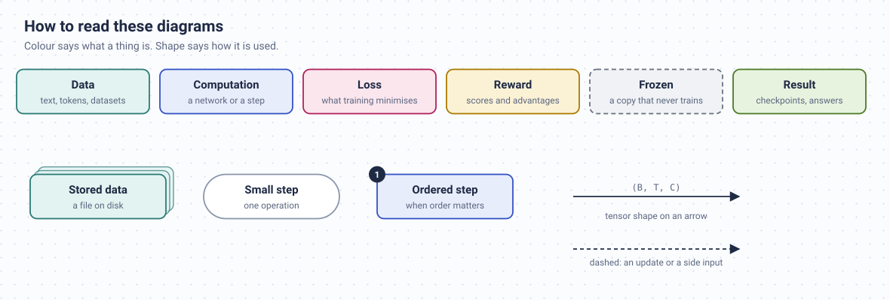

# Diagrams

Every figure in the README and on this site is an SVG generated from code in this folder. Nothing is
drawn by hand, so a diagram can be fixed with a one-line edit and the numbers in it come from the repo
itself:

- the token pieces and ids in `tokenization.svg`, `next_token_shift.svg` and `bpe.svg` are produced by
  `src/tokenizer/bpe.py` on a toy corpus;
- the model sizes come from the same code as `scripts/model_report.py`;
- the plots call the real functions they describe (`src/optim/schedules.py`, `src/optim/muon.py`,
  `src/models/modern/rope.py`, the attention mask and the `KVCache` class).



## Files

| File | What it does |
|---|---|
| `svgkit.py` | The drawing toolkit: the paper, the role colours, cards, chips and arrows. |
| `build_diagrams.py` | One function per diagram, registered by file name. |
| `build_plots.py` | The data plots, drawn with matplotlib in the same colours. |
| `*.svg` | The output, embedded by the README and the docs pages. |

## Change a diagram

Edit its function in `build_diagrams.py` (or `build_plots.py`), then from the repo root:

```bash
uv run python docs/diagrams/build_diagrams.py              # every diagram
uv run python docs/diagrams/build_diagrams.py grpo lora    # just these
uv run python docs/diagrams/build_plots.py                 # every plot
```

The diagram builder needs nothing beyond the project itself. The plots need matplotlib, which is in the
dev dependencies.

## Style rules

- **Colour is a role, never decoration.** Data is teal, computation cobalt, losses crimson, rewards
  mustard, frozen copies grey and dashed, results olive. Keep that mapping when adding a diagram.
- **Shape is a hint about use.** A stack of cards is stored data, a pill is a small step, a numbered badge
  appears only when the order really matters.
- **Arrows carry tensor shapes** like `(B, T, C)` wherever there is room. They are the most useful labels
  in the whole set.
- Sentence case everywhere, a title plus one caption line, and the viewer's system font. Monospace is only
  for real code: shapes, flags and file names.
