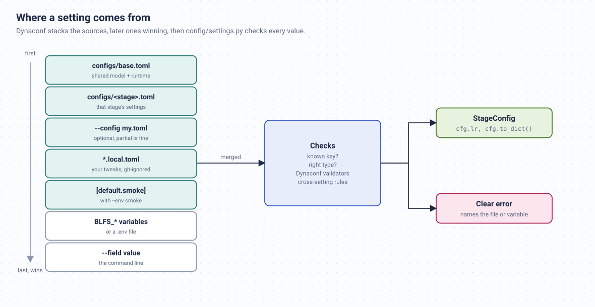

# Type Safety: Configs, Tensor Shapes and mypy

Most bugs in training code do not crash. A typo in a config key keeps the default value, a
tensor with an extra dimension broadcasts into a bigger one, and the run finishes with a
slightly wrong number that nobody notices. The repo catches these early at three levels:
typed configs at startup, tensor shapes in the tests, and static types in CI.



## 1. Settings, checked at startup

Every setting lives in a TOML file under `configs/`, and the `[default]` tables there are the complete
list of what exists. [`config/settings.py`](https://github.com/ghimiresunil/building-llms-from-scratch/blob/main/config/settings.py)
lets [Dynaconf](https://www.dynaconf.com/) merge `configs/base.toml`, the stage file, any
`*.local.toml`, the chosen `[default.NAME]` table, `BLFS_*` environment variables and the command
line. Then it checks the result in three steps:

1. **Known keys.** Anything not in the shipped `[default]` tables is a typo.
2. **Types.** Each value must match the type of its shipped default, so `lr` must be a number.
3. **Dynaconf validators** for choices and ranges (`loss_type` must be one of five losses, `beta`
   must be positive), then a few rules that involve two settings at once.

The command-line flags are generated from the same TOML files, so they can never drift apart.
These are real messages:

```text
$ python scripts/train_dpo.py --config my.toml          # my.toml: [default] betta = 0.1
train_dpo.py: error: my.toml: unknown key 'betta' for the dpo stage (did you mean 'beta'?)

$ python scripts/train_dpo.py --config my.toml          # my.toml: [default] loss_type = "dop"
train_dpo.py: error: my.toml: loss_type must be one of ['dpo', 'ipo', 'simpo', 'orpo', 'kto'], got 'dop'

$ python scripts/train_dpo.py --config my.toml          # my.toml has a top-level [smoke] table
train_dpo.py: error: my.toml: 'smoke' sits at the top level; put it under [default.smoke]

$ BLFS_BETA=-1 python scripts/train_dpo.py
train_dpo.py: error: environment variable BLFS_BETA: beta must be positive, got -1.0

$ python scripts/train_dpo.py --env smok
train_dpo.py: error: unknown environment 'smok' (did you mean 'smoke'?); configs/base.toml, configs/dpo.toml define: default, smoke, test

$ python scripts/pretrain_base.py --n_embed 100 --n_head 3
pretrain_base.py: error: n_embed (100) must be divisible by n_head (3) (from command line, configs/base.toml, configs/pretrain.toml)
```

TOML has real comments, so leave notes with `#`, and `--print-config` shows the final, merged
values without training.

The modern model has its own frozen dataclass, `ModernConfig`, which rejects impossible
shapes when it is built (for example `n_head` not divisible by `n_kv_head`, or an odd head
size, which RoPE cannot rotate).

## 2. Tensor shapes, checked in the tests

The newer modules annotate tensors with [jaxtyping](https://github.com/patrick-kidger/jaxtyping),
which puts the shape in the type:

```python
from jaxtyping import Float, Int
from torch import Tensor

def dpo_loss(
    policy_chosen_logps: Float[Tensor, "batch"],
    policy_rejected_logps: Float[Tensor, "batch"],
    ref_chosen_logps: Float[Tensor, "batch"],
    ref_rejected_logps: Float[Tensor, "batch"],
    beta: float = 0.1,
    label_smoothing: float = 0.0,
) -> LossAndRewards: ...

def forward(self, idx: Int[Tensor, "batch seq"], targets: Int[Tensor, "batch seq"] | None = None
            ) -> tuple[Float[Tensor, "batch seq vocab"], Float[Tensor, ""] | None]: ...
```

Every name is a dimension, and the same name must have the same size everywhere in one call:
all four inputs of `dpo_loss` must have the same `batch`. In a normal run these annotations
cost nothing, they are just documentation that cannot go stale. During the tests,
`tests/conftest.py` installs jaxtyping's import hook with [beartype](https://github.com/beartype/beartype),
which checks every call into the annotated modules.

Here is the kind of bug it catches. Pass a `(4, 1)` tensor where a `(4,)` one belongs:

```python
x = torch.randn(4)
dpo_loss(x, x, x, torch.randn(4, 1))
```

Without the check, PyTorch broadcasts the `(4,)` and `(4, 1)` tensors into a `(4, 4)` matrix,
averages 16 numbers instead of 4, and returns a perfectly plausible loss (0.67 in this case).
With the check:

```text
TypeCheckError: Type-check error whilst checking the parameters of src.post_training.dpo.dpo_loss.
The problem arose whilst typechecking parameter 'ref_rejected_logps'.
Actual value: f32[4,1](torch)
Expected type: <class 'Float[Tensor, 'batch']'>.
```

The checked modules are listed in `tests/conftest.py`: the modern model, LoRA, the optimizers,
the inference code, and the DPO and GRPO losses. Run the tests without the checks (to time
them, for example) with `SHAPE_CHECKS=0 pytest`.

## 3. Static types in CI

[mypy](https://mypy-lang.org/) reads the annotations without running anything. CI runs it on
`src/`, `config/` and `data_loader/`, and the modules added in this update are held to a
stricter standard: every function must be fully annotated (`disallow_untyped_defs` in
`pyproject.toml`). The packages ship a `py.typed` marker, so projects that import them get
the types too.

Some places where the static types earn their keep:

- `src/models/factory.py` returns `LanguageModel = Transformer | ModernTransformer`, so code
  that works with either model is checked against both.
- `src/tokenizer/__init__.py` describes what a tokenizer must provide as a `Protocol`, and both
  `tiktoken.Encoding` and the BPE tokenizer satisfy it without inheriting from anything.
- Config fields typed as `Literal[...]`, with mypy's `strict_equality` on, make a misspelled
  `cfg.loss_type == "simpo "` a type error instead of a branch that is never taken.

## Running the checks

```bash
uv sync                 # installs the dev group: pytest, beartype, ruff, mypy
uv run ruff check .     # style and common bugs
uv run mypy             # static types
uv run pytest           # tests, with runtime shape checks
uv run pytest -m "not slow"   # skip the end-to-end pipeline test (a few minutes on a CPU)
```

`pre-commit install` runs ruff on every commit. When you add code, annotate the tensors in its
signatures; if the module is new, add it to `CHECKED_MODULES` in `tests/conftest.py` and to the
strict list in `pyproject.toml`.
